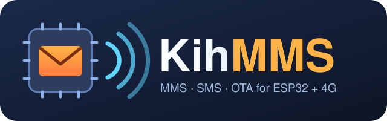

<p align="center"></p>

# KihMMS

**MMS and SMS for ESP32 with SIMCom A76xx 4G modems** – an Arduino library.

> 🚧 **Work in progress.** This repository currently contains the byte-level core (building MMS, decoding SMS in PDU mode,
> reading MMS notifications and messages). The modem driver, the PPP transfer and the examples are being moved in from
> the project where all of this was developed and tested on real hardware. See [Status](#status).

🇳🇴 [Norsk versjon](README.no.md)

## Why?

Sending an MMS from a microcontroller is usually considered a dead end: most A76xx modems have no MMS commands, and the
modem's own TCP stack can be blocked by the SIM card. KihMMS gets around both:

- **The ESP32 builds the MMS itself** (OMA MMS 1.2 / WSP encoding) – text, emoji, pictures, sound or any binary attachment.
- **MMS goes over PPP**: the ESP32 takes the data connection through the modem and does TCP with its own network stack,
  so it works even when `AT+NETOPEN` only answers `ERROR`.
- **SMS in PDU mode**, decoded on the ESP32: the GSM 7-bit alphabet with æøå and the extension table (€ [ ] { } …), UCS2
  with emoji (surrogate pairs), long SMS joined, and binary SMS – which is how MMS notifications (WAP push) arrive.

Everything has been tried on a real board with a Norwegian SIM card (Ice): sending text and pictures, fetching received MMS
(GIF, JPEG, ~300 KB), replying automatically, and **updating the board's firmware over MMS** (OTAMMS, see below).

## Install

**Arduino IDE:** download [KihMMS-0.2.1.zip](https://github.com/K-I-H/KihMMS/archive/refs/tags/v0.2.1.zip), then
*Sketch → Include Library → Add .ZIP Library…* and pick the file. (Newest from `main`:
[main.zip](https://github.com/K-I-H/KihMMS/archive/refs/heads/main.zip).)

**arduino-cli:**

```bash
arduino-cli config set library.enable_unsafe_install true
arduino-cli lib install --git-url https://github.com/K-I-H/KihMMS.git
```

Then `#include <KihMMS.h>`. Requires the ESP32 core (arduino-esp32 3.x). The library will be submitted to the Arduino
Library Manager when the modem driver and examples are in.

## Hardware

| | |
|---|---|
| **Modem** | SIMCom **A76xx** family: A7670E, A7670G, A7670SA (tested: A7670SA-FASE, firmware A011B09A7670M7) |
| **Board** | **LilyGO T-A7670E/G/SA** (tested: T-A7670G R2, ESP32-WROVER-E with 8 MB PSRAM) – or any ESP32 wired to an A76xx |
| **ESP32 core** | arduino-esp32 **3.x** (uses the built-in `PPP` library) |
| **Recommended** | PSRAM (an MMS can be 300 KB), an SD card for pictures, a 18650 battery or a good 5 V supply (the modem draws up to 2 A) |

Default pins (LilyGO T-A7670): modem TX/RX on GPIO 26/27, PWRKEY 4, modem power 12, SD card CS 13 / SCK 14 / MISO 2 / MOSI 15.

## What's in the box

| File | What |
|---|---|
| `src/kih_pdu.h` | `KihMmsBuilder` (M-Send.req), `KihSmsPdu` (SMS-DELIVER decoder), `KihMmsParser` (notification, retrieve-conf, parts). Plain C++ (no Arduino types). |
| `extras/docs/FINDINGS.md` | What blocks MMS on these modems and how it was solved – the notes we wish we had found. |
| `extras/docs/OPERATORS.md` | MMS settings (APN, MMSC, proxy) per operator, and which are tested. |

## Examples

Open them in the Arduino IDE under *File → Examples → KihMMS*.

| Example | What it shows | Needs |
|---|---|---|
| **BuildMms** | Build an MMS with subject, text (æøå, emoji) and an attachment; print it and read it back | any ESP32 |
| **DecodeSmsPdu** | Decode SMS in PDU mode: GSM 7-bit with æøå and €, UCS2 with emoji, sender with letters | any ESP32 |
| **ParseMmsNotification** | Read an MMS notification: sender, subject and the URL where the MMS is fetched | any ESP32 |
| **SendSms** | Switch on the modem and send an SMS with AT commands | LilyGO T-A7670 + SIM |
| **ReceiveSms** | Receive SMS (stored on the SIM, read in PDU mode) and decode them; recognise MMS notifications ✅ *tested on T-A7670G* | LilyGO T-A7670 + SIM |

## OTAMMS – firmware over MMS

A new program for the board, delivered as MMS: the program file is split into pieces, each piece is signed (HMAC-SHA256
with a secret key) and sent as an MMS attachment. The board collects the pieces, checks the CRC of each piece and the
signature of the whole program, writes it with `Update` and restarts. The board replies by SMS for each piece. An Android
app sends the pieces directly (ordinary messaging apps filter unknown attachments). Tested: 620 KB in 3 MMS, about 2 minutes
from the first message to the new program running. Coming to this repository together with the driver.

## Status

- [x] MMS encoder, SMS PDU decoder, MMS notification/message parser
- [ ] Modem driver (`KihModem`: SMS send/receive, SIM storage, network status)
- [ ] MMS over PPP (send with attachment, fetch and save to SD)
- [x] Examples: build MMS, decode SMS, parse MMS notification, send SMS, receive SMS
- [ ] Examples with the driver: send MMS, picture from SD, receive to SD, auto-reply
- [ ] OTAMMS receiver, Python packer and the Android sender app

## License

MIT – see [LICENSE](LICENSE).
