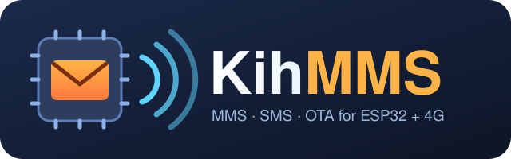

<p align="center"></p>

# KihMMS

[](https://github.com/K-I-H/KihMMS/actions/workflows/compile.yml) [](LICENSE)  

**Send og motta MMS og SMS fra en ESP32 med et SIMCom A76xx 4G-modem** (LilyGO T-A7670) – et Arduino-bibliotek uten andre
avhengigheter.

```cpp
#include <KihMMS.h>
#include <SD.h>
KihMms modem;

void setup() {
  Serial.begin(115200);
  SPI.begin(KIH_A7670_SD_SCK, KIH_A7670_SD_MISO, KIH_A7670_SD_MOSI);
  SD.begin(KIH_A7670_SD_CS);
  modem.onReady = [] { modem.sendMmsFile("+4712345678", "Hei", "Et bilde fra ESP32-en min", SD, "/bilde.jpg"); };
  modem.onSms = [](const char *fra, const char *tekst) { Serial.printf("SMS fra %s: %s\n", fra, tekst); };
  modem.onMms = [](const KihMmsReceived &m) { m.save(m.findPart("image/"), SD, "/mottatt.jpg"); };
  modem.begin();                       // pinnene på LilyGO T-A7670
}
void loop() { modem.loop(); }          // venter aldri
```

🇬🇧 [English version](README.md)

## Kom i gang (5 minutter)

1. **Kort:** en LilyGO T-A7670E/G/SA med et SIM-kort som har mobildata og MMS i abonnementet.
2. **Arduino IDE:** installer *esp32 by Espressif* (3.x) i Boards Manager, og KihMMS (se [Installering](#installering)).
3. **Kortinnstillinger:** *Verktøy → Kort → ESP32 Dev Module* (eller *ESP32 Wrover Module*), *Verktøy → PSRAM → Enabled*.
4. Åpne *Fil → Eksempler → KihMMS → **SendMms***, skriv telefonnummeret ditt i `TO_NUMBER`, og last opp.
5. Åpne seriellmonitoren (115200). Etter 10–30 s: `✅ MMS sent` – og bildet kommer på telefonen.

MMS-innstillingene (APN, MMSC, proxy) finnes fra SIM-kortet for operatørene i [OPERATORS.md](extras/docs/OPERATORS.md)
(Ice, Telenor, Telia og flere i Norden). For andre: én linje, `modem.setOperator("apn", "http://mmsc", "proxy", 8080);`

## Eksempler

Åpnes i Arduino IDE under *Fil → Eksempler → KihMMS*. **Begynn med SendMms.** (Kommentarene i eksemplene er på engelsk.)

| Eksempel | Hva det gjør | Trenger |
|---|---|---|
| ⭐ **SendMms** | Det korteste: sender én MMS med emne, tekst og et bilde (innebygd, uten SD-kort) | T-A7670 + SIM |
| 📷 **MmsFromSdCard** | SMS «photo» til kortet → det svarer med en MMS med `/photo.jpg` fra SD-kortet; også «list» og «send &lt;fil&gt;» | T-A7670 + SIM + SD-kort |
| 💾 **SaveMmsToSd** | Alle bilder, lyder og videoer som kommer på MMS, lagres på SD-kortet, og avsenderen får en kvittering på SMS | T-A7670 + SIM + SD-kort |
| 💬 **SmsAndMms** | SMS og MMS inn og ut, svar på MMS med SMS, kommandoer fra seriellmonitoren, et bilde ESP32-en tegner selv ✅ *prøvd* | T-A7670 + SIM |
| 📨 **OtaMms** | OTAMMS: nytt program til kortet over MMS, med signatursjekk og bekreftelse ✅ *prøvd* | T-A7670 + SIM, OTAMMS-appen |
| 📍 **GnssPosition** | Posisjon fra modemets GNSS-mottaker hvert 5. sekund, med kartlenke ✅ *prøvd* | T-A7670G + GPS-antenne |
| ✉️ **SendSms** | Slå på modemet og send en SMS, steg for steg med delene på lavt nivå ✅ *prøvd* | T-A7670 + SIM |
| 📥 **ReceiveSms** | Motta SMS (lagret på SIM, PDU-modus) og kjenn igjen MMS-varsler, med delene på lavt nivå ✅ *prøvd* | T-A7670 + SIM |
| 🧱 **BuildMms** | Lag en MMS byte for byte og les den tilbake – uten modem | hvilken som helst ESP32 |
| 🔍 **DecodeSmsPdu** | Dekod SMS i PDU-modus: æøå, €, emoji, avsender med bokstaver – uten modem | hvilken som helst ESP32 |
| 🔔 **ParseMmsNotification** | Les et MMS-varsel: avsender, emne, hvor den hentes – uten modem | hvilken som helst ESP32 |

✅ *prøvd* = kjørt på en LilyGO T-A7670G R2 med norsk SIM-kort (Ice). De andre kompileres for ESP32 på GitHub ved hver endring.

## API-et i én tabell

Alt går gjennom ett objekt, `KihMms modem;`. `loop()` venter aldri, så din egen kode fortsetter å gå.

| Kall | Hva |
|---|---|
| `modem.begin()` | Start med pinnene på LilyGO T-A7670. Andre kort: `modem.begin(Serial1, rx, tx, pwrkey, strøm)` |
| `modem.loop()` | Kalles i `loop()` – gjør alt arbeidet, venter aldri |
| `modem.onReady = [] { … }` | Modemet er på og SIM-kortet lest: nå kan du sende |
| `modem.sendSms(nummer, tekst)` | SMS med æøå, € og emoji; lange tekster deles. Valgfritt 3. argument: `[](bool ok) { … }` |
| `modem.sendMms(nummer, emne, tekst)` | MMS med bare tekst |
| `modem.sendMms(nummer, emne, tekst, data, lengde, "image/jpeg", "bilde.jpg")` | MMS med vedlegg fra minnet (det kopieres) |
| `modem.sendMmsFile(nummer, emne, tekst, SD, "/bilde.jpg")` | MMS med en fil fra SD, SD_MMC eller LittleFS; typen tas fra filendelsen |
| `modem.onMmsSent = [](bool ok, const char *status) { … }` | Hvordan det gikk med MMS-en |
| `modem.onSms = [](const char *fra, const char *tekst) { … }` | En SMS kom |
| `modem.onMms = [](const KihMmsReceived &m) { … }` | En MMS kom og er hentet: `m.from`, `m.subject`, `m.text`, `m.count`, `m.parts[i].type`/`.len`, `m.partData(i)` |
| `m.findPart("image/")`, `m.save(i, SD, "/x.jpg")`, `m.extension(i)` | Finn en del, lagre den som fil, en filendelse som passer |
| `modem.lastError()` | Hvorfor siste `send…` svarte `false` |
| `modem.mmsReady()`, `modem.networkCode()` | MMS-innstillingene kjent? SIM-kortets nettkode (f.eks. `24214`) |
| `modem.setOperator(apn, mmsc, proxy, port)` | MMS-innstillinger for hånd |

Én MMS sendes om gangen: vent på `onMmsSent` før neste. De fleste operatører tar imot opptil ca. 300 KB per MMS.

## Feilsøking

| Problem | Prøv dette |
|---|---|
| Ingenting skjer etter `Starting the modem` | Modemet trenger god strøm (opptil 2 A): bruk et ladet 18650-batteri eller en kraftig USB-port. Første start kan ta 30 s. |
| `MMS settings … unknown` | Operatøren din står ikke i tabellen: finn MMS-innstillingene på operatørens nettside og bruk `modem.setOperator(…)` (og si gjerne fra i en issue!). |
| `MMS NOT sent: no PPP connection` | Mobildata er av i abonnementet, eller det er ikke dekning. Sjekk at SMS virker først. |
| `not enough memory` | *Verktøy → PSRAM → Enabled*. |
| MMS-en kommer fram, men uten bildet | Bildet er for stort for operatøren: hold det under ca. 300 KB. |
| Opplastingen feiler med *Wrong boot mode* | SD-kortet holder GPIO 2 høy på T-A7670: ta det ut mens du laster opp, eller hold BOOT-knappen. |
| Avsenderen er `47…` uten `+` | Rettes av biblioteket: `m.from` kan svares på direkte. |

Mer bakgrunn: [FINDINGS.md](extras/docs/FINDINGS.md) (hva som stopper MMS på disse modemene, og hvordan det ble løst) og
[AT-COMMANDS.md](extras/docs/AT-COMMANDS.md) (på engelsk).

## Installering

**Arduino IDE:** last ned [KihMMS-0.4.0.zip](https://github.com/K-I-H/KihMMS/archive/refs/tags/v0.4.0.zip), og velg
*Skisse → Inkluder bibliotek → Legg til .ZIP-bibliotek …* og fila. (Nyeste fra `main`:
[main.zip](https://github.com/K-I-H/KihMMS/archive/refs/heads/main.zip).)

**arduino-cli:**

```bash
arduino-cli config set library.enable_unsafe_install true
arduino-cli lib install --git-url https://github.com/K-I-H/KihMMS.git
```

**PlatformIO:** `lib_deps = https://github.com/K-I-H/KihMMS.git` (med arduino-esp32 3.x og PSRAM på).

Deretter `#include <KihMMS.h>`. Krever ESP32-kjernen (arduino-esp32 3.x).

## Hvorfor?

MMS fra en mikrokontroller regnes som en blindvei: de fleste A76xx-modemer har ingen MMS-kommandoer, og modemets egen
TCP kan være sperret av SIM-kortet. KihMMS går rundt begge deler:

- **ESP32 lager MMS-en selv** (OMA MMS 1.2 / WSP) – tekst, emoji, bilder, lyd eller hvilket som helst vedlegg.
- **MMS går over PPP**: ESP32 tar datatilkoblingen gjennom modemet og gjør TCP med sin egen nettstakk, så det virker selv
  når `AT+NETOPEN` bare svarer `ERROR`.
- **SMS i PDU-modus**, dekodet på ESP32: GSM-alfabetet med æøå og utvidelsestabellen (€ [ ] { } …), UCS2 med emoji, lange
  SMS-er satt sammen, og binære SMS-er – som er slik MMS-varsler (WAP push) kommer.

Alt er prøvd på et ekte kort med norsk SIM-kort (Ice): sende tekst og bilder, hente mottatte MMS (GIF, JPEG, ~300 KB), svare
automatisk, og **oppdatere programmet på kortet over MMS** (OTAMMS, se under).

## Maskinvare

| | |
|---|---|
| **Modem** | SIMCom **A76xx**: A7670E, A7670G, A7670SA (prøvd: A7670SA-FASE, fastvare A011B09A7670M7) |
| **Kort** | **LilyGO T-A7670E/G/SA** (prøvd: T-A7670G R2, ESP32-WROVER-E med 8 MB PSRAM) – eller en ESP32 koblet til et A76xx |
| **ESP32-kjerne** | arduino-esp32 **3.x** (bruker det innebygde `PPP`-biblioteket) |
| **Anbefalt** | PSRAM (en MMS kan være 300 KB), SD-kort til bilder, et 18650-batteri eller god 5 V (modemet trekker opptil 2 A) |

Pinnene på LilyGO T-A7670 (også som konstanter): modem RX/TX `KIH_A7670_RX` 27 / `KIH_A7670_TX` 26, `KIH_A7670_PWRKEY` 4,
strøm til modemet `KIH_A7670_POWER` 12, SD-kort `KIH_A7670_SD_CS` 13 / `_SCK` 14 / `_MISO` 2 / `_MOSI` 15.

## Innhold

| Fil | Hva |
|---|---|
| `src/kih_mms.h` | **`KihMms`**: alt i ett objekt – SMS og MMS inn og ut, innkommende MMS hentes av seg selv, operatøren fra SIM-kortet. |
| `src/kih_at.h` | `KihAt`: én AT-kommando om gangen fra en kø, svarene leses i `loop()` uten å vente, meldinger fra modemet til `onUrc`. |
| `src/kih_power.h` | `KihPower`: slår på modemet (spør først, så et modem som går, ikke slås av av PWRKEY). |
| `src/kih_sms.h`, `src/kih_smsout.h` | `KihSms`: SMS lagret på SIM-kortet, lange SMS satt sammen; `KihSmsSubmit`: GSM 7-bit eller UCS2, lange SMS delt (emoji deles aldri). |
| `src/kih_ppp.h` | `KihPpp`: datatilkobling gjennom modemet med PPP; AT-laget tar pause og fortsetter etterpå. |
| `src/kih_mmsget.h`, `src/kih_mmssend.h` | `KihMmsGet` / `KihMmsSend`: hente og sende MMS gjennom operatørens MMS-proxy. |
| `src/kih_gnss.h` | `KihGnss`: posisjon, fart, tid og satellitter fra `AT+CGNSSINFO`. Ren C++. |
| `src/kih_otamms.h`, `src/kih_fwpiece.h` | `KihOtaMms`: OTAMMS-mottakeren (nummer, CRC, versjon, signatur, Update, bekreftelse); `KihFwPiece` / `KihSha256`: bitformatet og HMAC-SHA256, ren C++. |
| `src/kih_pdu.h` | `KihMmsBuilder` (M-Send.req), `KihSmsPdu` (SMS-dekoder), `KihMmsParser` (varsel, hentet melding, deler). Ren C++ (uten Arduino-typer). |
| `extras/docs/FINDINGS.md` | Hva som stopper MMS på disse modemene, og hvordan det ble løst (på engelsk). |
| `extras/docs/OPERATORS.md` | MMS-innstillinger per operatør, og hvilke som er prøvd. |
| `extras/docs/AT-COMMANDS.md` | Jukselapp: A76xx-kommandoene for SMS (og GNSS), med innstillingene som virker og hvorfor (på engelsk). |

## OTAMMS – nytt program over MMS

Programfila deles i biter, hver bit signeres (HMAC-SHA256 med en hemmelig nøkkel) og sendes som MMS-vedlegg. Kortet samler
bitene, sjekker CRC og signaturen, skriver programmet med `Update` og starter på nytt, og svarer på SMS for hver bit. En
Android-app sender bitene direkte.
Versjonen i hver pakke er tidspunktet den ble signert: en nyere pakke godtas alltid (også med et eldre program),
men en gammel pakke kan ikke sendes på nytt. Når det nye programmet kjører, sier det fra på SMS. Mottakeren er `KihOtaMms`
(eksempelet **OtaMms**). Prøvd: 1 MB i 5 MMS-er, ca. 5 minutter fra første melding til bekreftelsen. Android-appen ligger ikke
her ennå.

## Status

- [x] MMS-pakken, SMS-dekoderen, lesing av MMS-varsler og -meldinger
- [x] Modemdriveren: AT-kø, påslåing, SMS inn og ut (lagret på SIM, lange SMS, emoji), GNSS
- [x] MMS over PPP: hente og sende, med automatisk henting og operatøren fra SIM-kortet (`KihMms`)
- [x] Enkelt API: `begin()` med kortets pinner, `onReady`, `sendMmsFile`, `m.save`, `lastError`
- [x] Eksempler: send MMS, MMS fra SD-kortet, lagre mottatt MMS på SD, SMS og MMS, OTAMMS, GNSS, og de på lavt nivå
- [x] OTAMMS-mottakeren (`KihOtaMms`) med versjonssjekk og bekreftelse
- [ ] OTAMMS: Python-pakker og Android-appen
- [ ] Flere operatører prøvd (åpne gjerne en issue med din!)

## Lisens

MIT – se [LICENSE](LICENSE).
